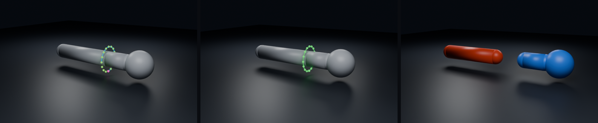
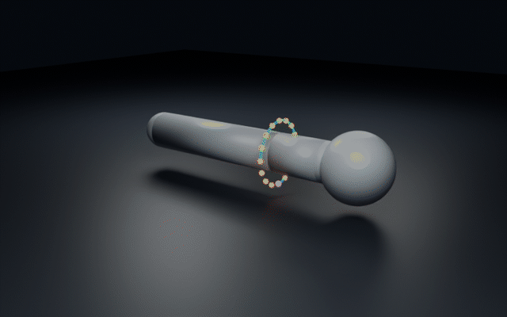

# PolyCutter Limbs


Addon de Blender para **separar extremidades o piezas de una malla** dibujando un lazo editable alrededor. El lazo se puede ajustar punto a punto antes de aplicar el corte, y el resultado son **dos piezas cerradas** (sin agujeros).





<sub>Ilustración generada con Blender (render 3D del proceso; no es una captura de la interfaz).</sub>

## Características

- **Lazo editable**: arrastra cualquier punto para recolocarlo sobre la superficie; inserta o borra puntos.
- **Cerrar sin cortar**: une el primer y el último punto para previsualizar el lazo; el corte se aplica solo cuando tú quieres.
- **Botón único**: HUD en la vista 3D y panel N con los mismos comandos.
- **Corte robusto**: membrana con grosor (mm) + booleana con solvers *MANIFOLD/EXACT* y separación automática en las dos piezas mayores.
- **Multi-tramo**: dibuja por delante y por detrás de la pieza orbitando entre tramos.
- **Rendimiento**: cachés de HUD, proyección de puntos y batches GPU.

## Instalación

1. Descarga `PolyCutter-1.0.0.zip` desde [Releases](../../releases).
2. En Blender: **Edit → Preferences → Add-ons → Install from Disk…**
3. Selecciona el zip y activa **PolyCutter Limbs (separar piezas)**.

> Recomendado Blender **4.2 o superior** (probado en 5.2).
> Si tenías una versión anterior de un solo archivo (`.py`), desactívala para no duplicar el panel.

### Desde el código fuente

```bash
git clone <url-del-repo>
cd PolyCutter
python build.py          # genera PolyCutter-1.0.0.zip
```

Instala el zip generado, o copia la carpeta `PolyCutter/` en el directorio de addons de Blender.

## Uso

1. Selecciona una **malla** y abre el panel **N → PolyCutter**.
2. Pulsa **Separar extremidad**.
3. **Dibuja** alrededor de la pieza con LMB. Puedes soltar, orbitar (MMB) y seguir dibujando por detrás.
4. **Cierra el lazo**: clic en el punto verde o tecla `C` (todavía no corta).
5. **Ajusta**: arrastra los puntos, inserta (`Shift+clic` sobre el lazo) o borra (`X` sobre un punto).
6. Pulsa **APLICAR CORTE** (HUD o panel) o `Ctrl+Enter`.

El resultado son dos objetos nuevos: `<nombre>_A` y `<nombre>_B`.

### Atajos

| Acción | Atajo |
|---|---|
| Modo dibujar | `D` |
| Modo mover | `M` |
| Arrastrar un punto | clic sobre el punto |
| Insertar punto | `Shift+clic` sobre el lazo |
| Borrar punto | `X` / `Supr` con el cursor encima |
| Cerrar / abrir lazo | `C` o clic en el punto verde |
| Deshacer tramo | `Ctrl+Z` / `Retroceso` |
| Aplicar corte | `Ctrl+Enter` o botón |
| Cancelar | `Esc` |
| Orbitar / zoom | MMB / rueda (la herramienta no los intercepta) |

### Ajustes del panel

| Ajuste | Descripción |
|---|---|
| **Grosor de corte (mm)** | Grosor de la membrana que corta (sube si el corte falla). |
| **Ocultar original** | Oculta la malla original tras separar. |
| **Transparencia** | Transparencia de la vista X-Ray mientras dibujas. |

## Problemas frecuentes

- **«El lazo no separó la pieza»**: el lazo debe rodear **completamente** la extremidad y estar cerrado.
- **«Solo se obtuvo una pieza útil»**: el lazo no atraviesa toda la pieza; llévalo hasta el otro lado.
- **La booleana falla**: aumenta el **Grosor de corte**; el addon prueba *MANIFOLD* y *EXACT* automáticamente.
- **No aparece el panel**: debe haber una malla activa y estar en la Vista 3D; busca la pestaña **PolyCutter** en la barra lateral (`N`).

## Desarrollo

```
PolyCutter/
├── __init__.py      # bl_info y registro
├── config.py        # versión, colores, métricas, textos
├── session.py       # estado de sesión y tabla de comandos
├── geometry.py      # kernel de corte (membrana, booleana, split)
├── hud.py           # HUD y vista previa 3D (con cachés)
├── operators.py     # operador modal y puente del panel
└── panel.py         # panel N
build.py             # genera el zip instalable
run_smoke.py         # pruebas de humo dentro de Blender
```

- **Empaquetar**: `python build.py`
- **Smoke test**:

```bash
blender --background --factory-startup --python-exit-code 1 --python run_smoke.py
```

El workflow de GitHub Actions valida sintaxis y genera el zip en cada push, y publica una Release al empujar un tag `v*`.

## Changelog

Ver [CHANGELOG.md](CHANGELOG.md).

## Licencia

[GPL-3.0-or-later](LICENSE) © PolyCutter

---

### English summary

PolyCutter Limbs is a Blender add-on (4.2+) that cuts a mesh in two closed pieces using an editable loop drawn around a limb. Drag points, close the loop without cutting, and apply the cut with one button. GPL-3.0-or-later.
